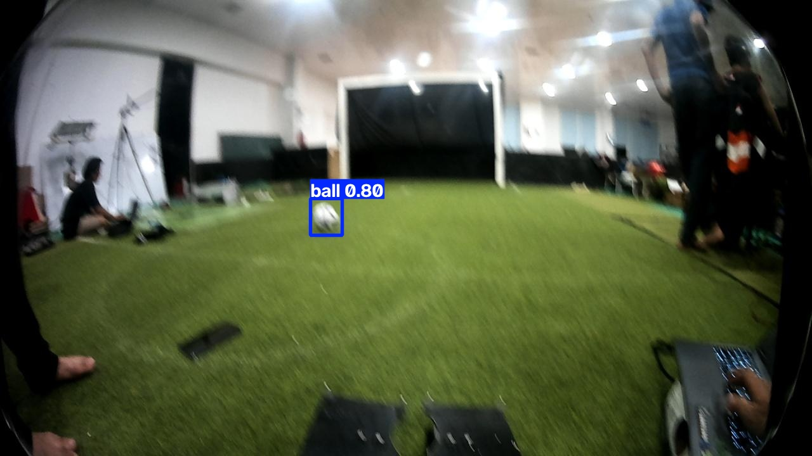
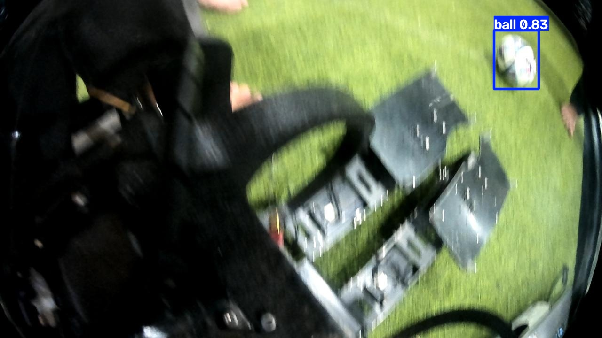

# Deteksi Bola Humanoid Soccer dengan YOLO26n

Saya membandingkan ukuran input **416** dan **640** untuk mendeteksi bola dari gambar lapangan humanoid soccer. Kedua eksperimen memakai bobot pretrained YOLO26n, dataset, dan pengaturan training yang sama.

**RET503 · PJ1**  
Dedek Mulyadi · 4222401050  
Percobaan: 17 Oktober 2026


**E3 terpilih** dengan mAP50–95 validasi **72,46%**, naik **1,53 poin persentase** dari E1. Pada pengujian akhir, E3 mencatat mAP50–95 **71,34%** dan recall **98,48%**.

[Hasil validasi](#hasil-validasi) · [Hasil test](#hasil-test) · [Contoh deteksi](#contoh-deteksi) · [Menjalankan ulang](#menjalankan-ulang-percobaan) · [Laporan lengkap](hasil_praktik/percobaan_01/README.md)

## Hasil validasi

| Eksperimen | Input | mAP50 | mAP50–95 | Precision | Recall |
|---|---:|---:|---:|---:|---:|
| **E1** | 416 | 99,20% | 70,93% | 98,22% | 98,84% |
| **E3** | 640 | 99,27% | 72,46% | 97,99% | 99,61% |

Tabel memakai hasil evaluasi ulang `best.pt` pada 264 gambar validasi. Semua metrik ditampilkan dalam persen; angka sumber tersimpan dalam [CSV perbandingan](hasil_praktik/percobaan_01/hasil_praktik_4222401050.csv).

### Apa yang berubah pada E3?

Ukuran input 640 menghasilkan mAP50–95 yang lebih tinggi **1,53 poin persentase** dan recall yang naik **0,78 poin persentase**. Precision turun tipis **0,23 poin persentase**, sedangkan training bertambah sekitar **2,00 menit**.

Hasil ini menjadi dasar pemilihan E3. Peningkatan metrik keseluruhan belum membuktikan bahwa semua bola jauh atau gambar blur sudah terdeteksi dengan baik.

## Perkembangan training


Kedua model belajar paling cepat pada awal training, lalu peningkatannya mulai mengecil. Box loss train dan validasi cenderung turun hingga akhir. Puncak mAP50–95 pada log training sama-sama muncul di epoch 27: **71,30% untuk E1** dan **72,77% untuk E3**. Angka pada kurva berasal dari evaluasi per epoch, sehingga tidak harus sama persis dengan evaluasi ulang `best.pt` pada tabel.

<details>
<summary><strong>Grafik training lengkap E1 dan E3</strong></summary>

### E1 · input 416


### E3 · input 640


[Log E1](hasil_praktik/percobaan_01/E1_pretrained/results.csv) · [Log E3](hasil_praktik/percobaan_01/E3_tuning/results.csv)

</details>

## Hasil test

E3 diuji pada **132 gambar test** setelah pemilihan model selesai. E1 tidak dievaluasi pada test.

| mAP50 | mAP50–95 | Precision | Recall |
|---:|---:|---:|---:|
| 99,48% | 71,34% | 99,89% | 98,48% |

mAP50–95 test lebih rendah **1,12 poin persentase** dari validasi. Hasil test dicatat sebagai evaluasi akhir, tanpa pemilihan ulang model berdasarkan angka tersebut.

[Angka test dalam CSV](hasil_praktik/percobaan_01/hasil_test_4222401050.csv) · [Hasil test dalam JSON](hasil_praktik/percobaan_01/hasil_test.json)

<details>
<summary><strong>Confusion matrix dan kurva precision–recall test</strong></summary>


Matriks tersimpan memuat **131 pasangan deteksi benar, 143 prediksi tanpa pasangan label, dan 1 objek terlewat** pada pengaturan pembentuk matriks. Angka ini tidak digunakan untuk menghitung ulang precision dan recall pada tabel. Ringkasan precision/recall Ultralytics memakai titik confidence dengan F1 maksimum, sedangkan confusion matrix menggambarkan hitungan pada ambang tertentu. Perbedaan ambang dapat menghasilkan hitungan yang berbeda.


[Penjelasan pengaturan evaluasi Ultralytics](https://docs.ultralytics.com/modes/val/)

</details>

## Contoh deteksi

Contoh berikut berasal dari hasil prediksi E3 pada gambar validasi. Nilai pada kotak adalah confidence prediksi, bukan nilai akurasi gambar.

| Bola berukuran kecil pada gambar | Bola di tengah lapangan |
|---|---|
|  |  |
| Confidence 0,69 | Confidence 0,80 |

| Sudut kamera miring | Bola dekat kamera |
|---|---|
|  |  |
| Confidence 0,83 | Confidence 0,88 |

Contoh ini menunjukkan variasi ukuran bola, kemiringan gambar, dan blur yang ada dalam data. Empat gambar belum mewakili seluruh keberhasilan maupun kegagalan model. [Seluruh hasil prediksi validasi](hasil_praktik/percobaan_01/prediksi/contoh/) tetap tersedia.

## Waktu proses

| Eksperimen | Training (menit) | Rata-rata (ms) | P95 (ms) | FPS detektor |
|---|---:|---:|---:|---:|
| E1 | 15,13 | 13,88 | 18,51 | 72,07 |
| E3 | 17,13 | 12,89 | 15,86 | 77,57 |

Benchmark memakai **batch 1, FP32**, 24 gambar validasi yang sama, dua putaran, dan tiga pemanasan. Gambar sudah dimuat sebelum pengukuran. Waktu mencakup pemanggilan model, preprocessing, dan postprocessing; kamera, baca file, ROS, display, serta kontrol robot belum dihitung.

Pada pengukuran ini, rata-rata E3 lebih singkat **0,98 ms**. Satu sesi benchmark belum cukup untuk menyatakan input 640 selalu lebih cepat. FPS pada tabel juga belum mewakili FPS keseluruhan robot.

## Dataset dan pengaturan

Dataset berisi **1.320 gambar** beresolusi **1280 × 720**, dengan satu kelas `ball` dan ID **0**.

| Bagian | Gambar | Kotak bola | Label kosong |
|---|---:|---:|---:|
| Train | 924 | 916 | 8 |
| Validasi | 264 | 258 | 6 |
| Test | 132 | 132 | 0 |
| **Total** | **1.320** | **1.306** | **14** |

Label kosong tersedia untuk gambar latar tanpa objek yang dianotasi. Pembagian **70/20/10** mengikuti ekspor Roboflow. Tidak ada duplikat persis dalam audit, tetapi pemisahan antarvideo atau sesi rekaman belum terverifikasi. Karena itu, skor ini belum menjadi bukti kemampuan pada sesi pertandingan yang berbeda.

| Pengaturan | E1 | E3 |
|---|---|---|
| Model awal | YOLO26n pretrained | YOLO26n pretrained yang sama |
| Ukuran input | **416** | **640** |
| Epoch | 30 | 30 |
| Batch | 8 | 8 |
| Optimizer | AdamW | AdamW |
| Learning rate awal | 0,001 | 0,001 |
| Seed | 42 | 42 |
| AMP saat training | Aktif | Aktif |

E3 memulai training dari bobot pretrained asli. Perubahan yang diuji hanya ukuran input; E2 tidak termasuk percobaan. Augmentasi training mengikuti konfigurasi Ultralytics yang sama, tanpa augmentasi offline tambahan dari Roboflow.

### Perangkat

| Komponen | Versi / perangkat |
|---|---|
| GPU | NVIDIA GeForce RTX 3050 Laptop, 6 GB |
| Python | 3.11.9 |
| PyTorch | 2.9.1+cu128 |
| Torchvision | 0.24.1+cu128 |
| Ultralytics | 8.4.178 |
| Runtime CUDA | 12.8 |

[Konfigurasi E1](hasil_praktik/percobaan_01/E1_pretrained/args.yaml) · [Konfigurasi E3](hasil_praktik/percobaan_01/E3_tuning/args.yaml) · [Daftar versi library](hasil_praktik/percobaan_01/requirements_used.txt)

## Menjalankan ulang percobaan

Folder proyek yang pendek, misalnya `C:\yolo`, menghindari masalah panjang path saat instalasi PyTorch. Perintah berikut memakai Python 3.11 langsung, tanpa kewajiban membuat virtual environment. Nama `percobaan_02` memisahkan hasil pengulangan dari hasil yang sudah tersimpan.

<details>
<summary><strong>Instalasi, training, analisis, dan prediksi</strong></summary>

### Instalasi

```powershell
py -3.11 -m pip install torch==2.9.1 torchvision==0.24.1 --index-url https://download.pytorch.org/whl/cu128
py -3.11 -m pip install -r requirements.txt
py -3.11 00_cek_gpu.py
```

### Persiapan dataset

Arsip dataset Roboflow menggunakan nama `dataset_bola.zip`.

```powershell
py -3.11 01_siapkan_dataset.py --zip dataset_bola.zip --out dataset_v2
```

### Training dan analisis

```powershell
py -3.11 02_train_e1_e3.py --data dataset_v2/data.yaml --nim 4222401050 --nama "Dedek Mulyadi" --epochs 30 --batch 8 --device 0 --workers 0 --run-name percobaan_02
py -3.11 03_uji_dan_analisis.py --run hasil_praktik/percobaan_02
```

### Contoh prediksi

```powershell
py -3.11 04_prediksi.py --run hasil_praktik/percobaan_02
```

Checkpoint training yang terputus dapat dilanjutkan dengan:

```powershell
py -3.11 02_train_e1_e3.py --resume hasil_praktik/percobaan_02
```

Jika batch 8 tidak muat di VRAM, pengulangan memakai batch 4 untuk kedua eksperimen dan nama run baru. Dataset, versi library, serta pengaturan lain tetap sama sepanjang satu perbandingan.

</details>

## Berkas hasil

| Berkas | Isi |
|---|---|
| [Laporan percobaan](hasil_praktik/percobaan_01/README.md) | Pembahasan hasil dan batas pengujian |
| [CSV perbandingan](hasil_praktik/percobaan_01/hasil_praktik_4222401050.csv) | Angka validasi dan benchmark E1/E3 |
| [CSV test](hasil_praktik/percobaan_01/hasil_test_4222401050.csv) | Evaluasi akhir E3 |
| [Model E1](hasil_praktik/percobaan_01/E1_pretrained/weights/best.pt) | Bobot terbaik E1 |
| [Model E3](hasil_praktik/percobaan_01/E3_tuning/weights/best.pt) | Bobot terpilih berdasarkan validasi |
| [Catatan run](hasil_praktik/percobaan_01/manifest.json) | Identitas dataset, konfigurasi, dan hasil pengukuran |

## Kesimpulan

Saya memilih **E3 dengan input 640** untuk percobaan ini karena mAP50–95 dan recall validasinya lebih tinggi. Hasil test mencatat mAP50–95 **71,34%** dan recall **98,48%**. Pengujian pada rekaman terpisah dan perangkat robot masih diperlukan sebelum menetapkan kemampuan deteksi saat pertandingan.

## Referensi

- [Ultralytics YOLO26](https://docs.ultralytics.com/models/yolo26/)
- [Training YOLO](https://docs.ultralytics.com/modes/train/)
- [Evaluasi dan pengaturan metrik](https://docs.ultralytics.com/modes/val/)
- [Instalasi PyTorch](https://pytorch.org/get-started/previous-versions/)
- [Ekspor dataset Roboflow](https://docs.roboflow.com/datasets/versions/dataset-versions/exporting-data)
