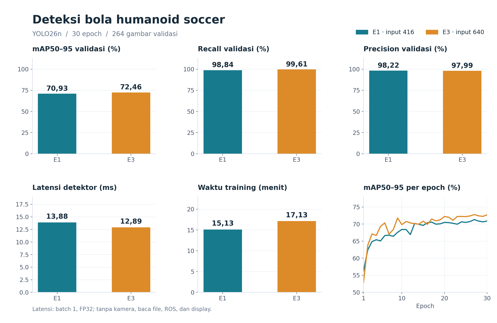
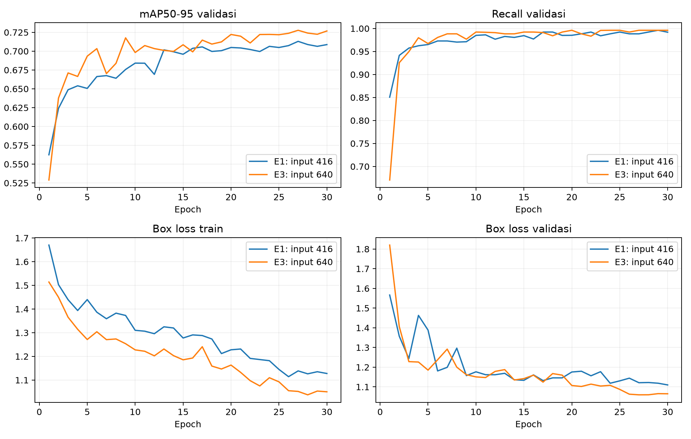
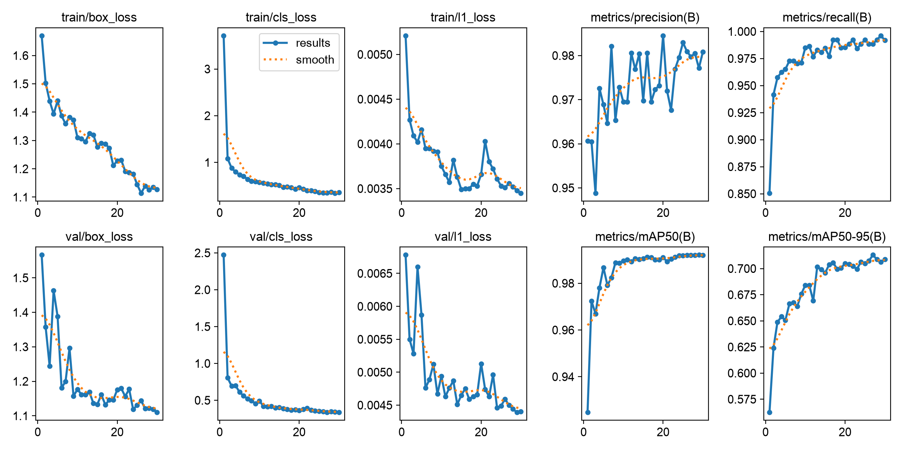
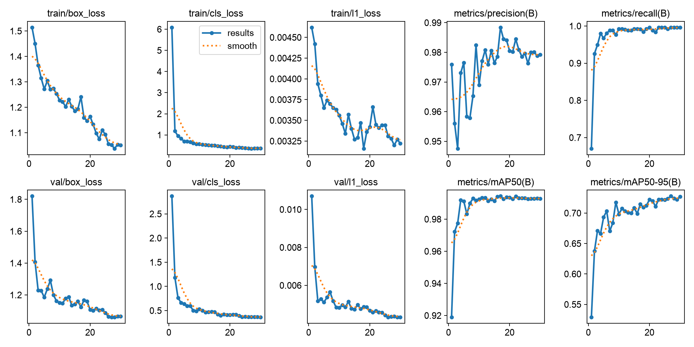
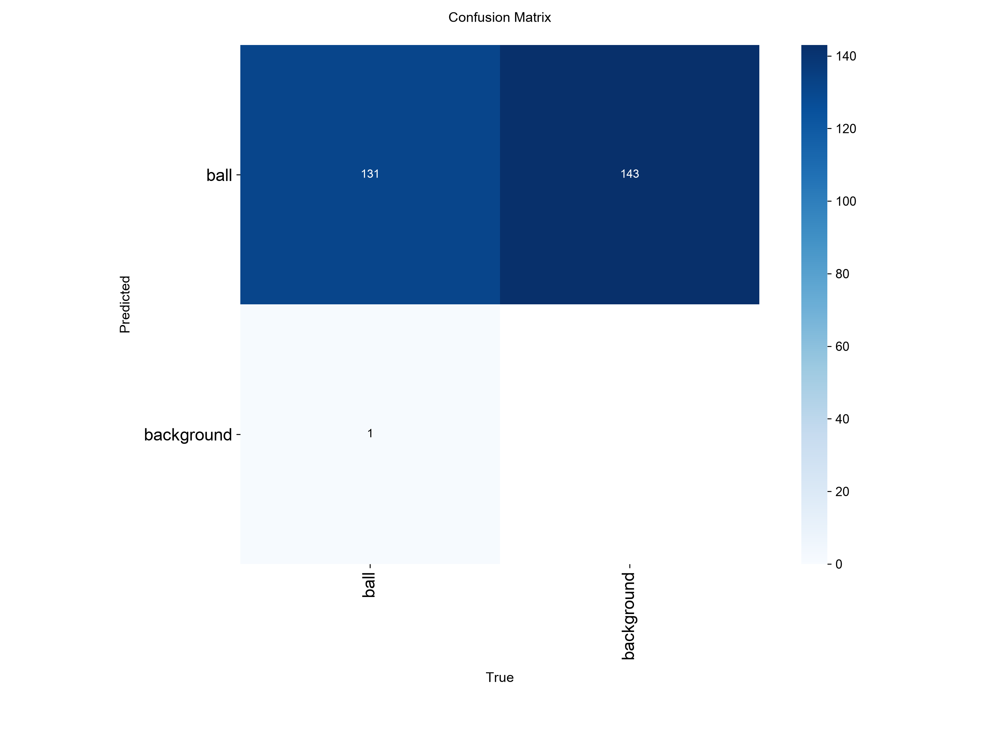
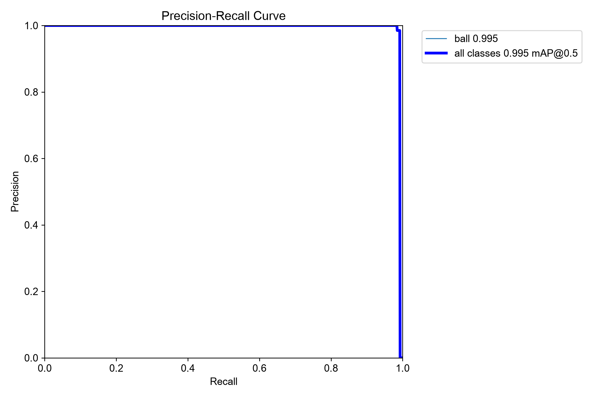
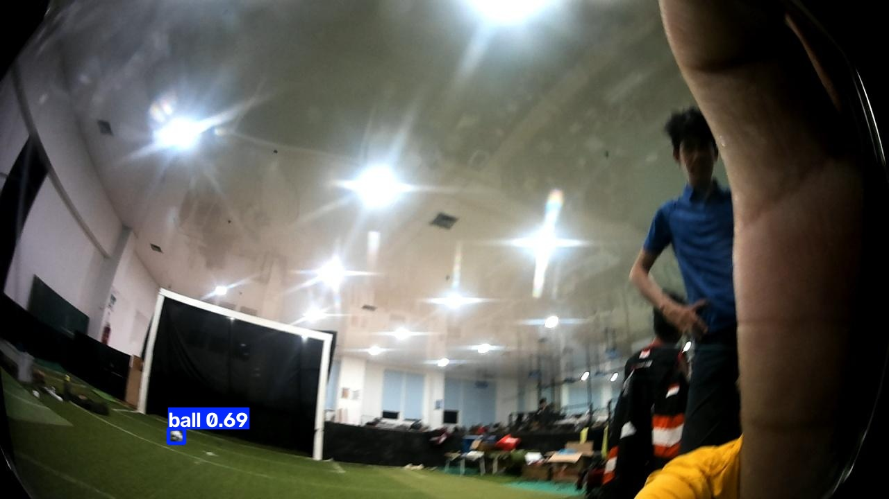
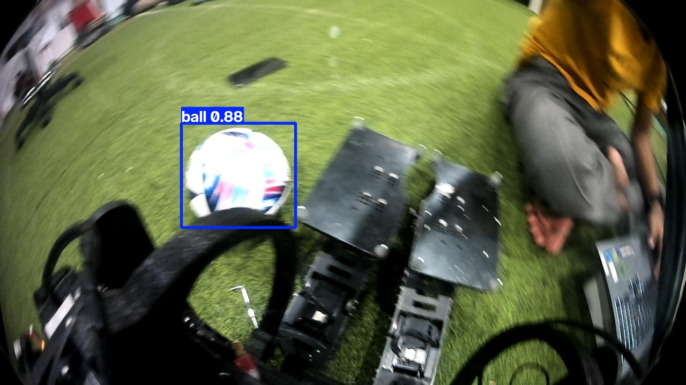

# Hasil Percobaan Deteksi Bola Humanoid Soccer

[Kembali ke halaman utama](../../README.md)

**Dedek Mulyadi · 4222401050**  
RET503 · PJ1 · 17 Oktober 2026  
YOLO26n · RTX 3050 Laptop 6 GB

## Rancangan percobaan

Saya membandingkan input 416 pada E1 dan 640 pada E3. Kedua model memulai training dari bobot pretrained YOLO26n yang sama, dengan 30 epoch, batch 8, seed 42, optimizer AdamW, learning rate awal 0,001, dan AMP aktif. Dataset serta pembagian train/validasi/test tidak berubah.

Model dipilih dari mAP50–95 validasi tertinggi. E3 memulai training tersendiri dari pretrained asli; E2 tidak dijalankan. Dengan rancangan ini, perbandingan hanya membahas pengaruh ukuran input.

## Dataset

| Bagian | Gambar | Kotak bola | Label kosong |
|---|---:|---:|---:|
| Train | 924 | 916 | 8 |
| Validasi | 264 | 258 | 6 |
| Test | 132 | 132 | 0 |
| **Total** | **1.320** | **1.306** | **14** |

Seluruh gambar beresolusi 1280 × 720 dan memakai kelas `ball` dengan ID 0. Pembagian mengikuti ekspor Roboflow, tanpa augmentasi offline tambahan. Audit tidak menemukan duplikat persis. Pemisahan berdasarkan video atau sesi pengambilan belum terverifikasi, sehingga hasil ini belum membuktikan kemampuan pada sesi pertandingan lain.

## Validasi E1 dan E3

| Eksperimen | Input | mAP50 | mAP50–95 | Precision | Recall |
|---|---:|---:|---:|---:|---:|
| **E1** | 416 | 99,20% | 70,93% | 98,22% | 98,84% |
| **E3** | 640 | 99,27% | 72,46% | 97,99% | 99,61% |

Angka berasal dari evaluasi ulang `best.pt` pada 264 gambar validasi. Skor ditampilkan dalam persen; sumber angka tersedia pada [CSV perbandingan](hasil_praktik_4222401050.csv) dan [manifest](manifest.json).

Input 640 meningkatkan mAP50–95 sebesar **1,53 poin persentase** dan recall sebesar **0,78 poin persentase**. Precision turun **0,23 poin persentase**. E3 dipilih karena mAP50–95 validasinya lebih tinggi.

## Perkembangan training

Metrik naik paling cepat pada awal training, kemudian mulai mendatar. Box loss train dan validasi cenderung turun hingga akhir. Tidak terlihat kenaikan box loss validasi yang terus berlangsung pada bagian akhir grafik, tetapi satu percobaan dengan satu seed belum cukup untuk memastikan pola generalisasi.

| Eksperimen | Epoch mAP50–95 tertinggi pada log | mAP50–95 pada log |
|---|---:|---:|
| E1 | 27 | 71,30% |
| E3 | 27 | 72,77% |

Log per epoch dan evaluasi ulang `best.pt` merupakan dua pencatatan yang berbeda. Tabel perbandingan memakai evaluasi ulang yang tersimpan dalam manifest.

<strong>Grafik training asli</strong>

### E1

### E3

## Waktu proses

| Eksperimen | Training (menit) | Rata-rata detektor (ms) | P95 (ms) | FPS detektor |
|---|---:|---:|---:|---:|
| E1 | 15,13 | 13,88 | 18,51 | 72,07 |
| E3 | 17,13 | 12,89 | 15,86 | 77,57 |

Training E3 membutuhkan sekitar **2,00 menit** lebih lama. Pada benchmark tersimpan, waktu rata-rata E3 justru **0,98 ms** lebih singkat. Selisih ini hanya berlaku untuk sesi pengukuran tersebut dan belum menunjukkan bahwa input lebih besar selalu lebih cepat.

Benchmark memakai 24 gambar validasi yang sama, dua putaran, tiga pemanasan, batch 1, dan FP32. Waktu mencakup pemanggilan Python, preprocessing, inference, dan postprocessing. Gambar sudah dimuat sebelumnya. Kamera, baca file, ROS, display, serta kontrol robot tidak termasuk pengukuran. FPS detektor belum mewakili FPS sistem robot.

## Pengujian akhir E3

E3 diuji pada 132 gambar test setelah pemilihan dari validasi selesai. Catatan evaluasi memuat satu percobaan test yang selesai pada 17 Oktober 2026 pukul 14.37 WIB.

| mAP50 | mAP50–95 | Precision | Recall |
|---:|---:|---:|---:|
| 99,48% | 71,34% | 99,89% | 98,48% |

mAP50–95 test berada **1,12 poin persentase** di bawah validasi. Selisih tersebut dapat dipengaruhi variasi gambar pada masing-masing bagian. Hasil test tidak dipakai untuk memilih ulang model.

<strong>Confusion matrix dan kurva precision–recall</strong>

Matriks tersimpan mencatat **131 pasangan deteksi benar, 143 prediksi tanpa pasangan label, dan 1 objek terlewat**. Ringkasan precision dan recall Ultralytics memakai confidence pada F1 maksimum, sedangkan matriks menggambarkan hitungan pada ambang tertentu. Karena itu, precision dan recall pada tabel tidak dihitung ulang dari matriks ini.

[Dokumentasi evaluasi Ultralytics](https://docs.ultralytics.com/modes/val/)

## Pengamatan contoh deteksi

| Bola kecil pada gambar | Bola dekat kamera |
|---|---|
|  |  |
| Confidence 0,69 | Confidence 0,88 |

Contoh lain memperlihatkan bola pada gambar miring dan blur. Hasil prediksi masih membentuk kotak di sekitar bola pada contoh yang ditampilkan. Contoh visual ini berasal dari validasi dan tidak menggantikan evaluasi pada seluruh data.

[Seluruh gambar prediksi](prediksi/contoh/)

## Kesimpulan

Saya memilih **E3 dengan input 640** berdasarkan mAP50–95 validasi **72,46%**. Dibanding E1, recall meningkat dengan sedikit penurunan precision dan tambahan waktu training. Pengujian akhir mencatat mAP50–95 **71,34%** dan recall **98,48%**.

Hasil ini berlaku untuk dataset dan perangkat pengujian yang tercatat. Pengujian pada rekaman terpisah, variasi seed, serta pengukuran kamera sampai keluaran deteksi di perangkat robot masih diperlukan untuk menilai penggunaan saat pertandingan.

## Catatan berkas

- [Perbandingan E1/E3](hasil_praktik_4222401050.csv)
- [Angka test](hasil_test_4222401050.csv)
- [Data test lengkap](hasil_test.json)
- [Konfigurasi dan identitas run](manifest.json)
- [Versi library](requirements_used.txt)

Dataset SHA256: `835a2a4bd6dac1d8f61580ec59212f0cb38b1cb4b0bf97f01e3b6a9d28ea6749`
