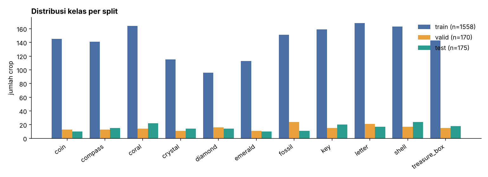
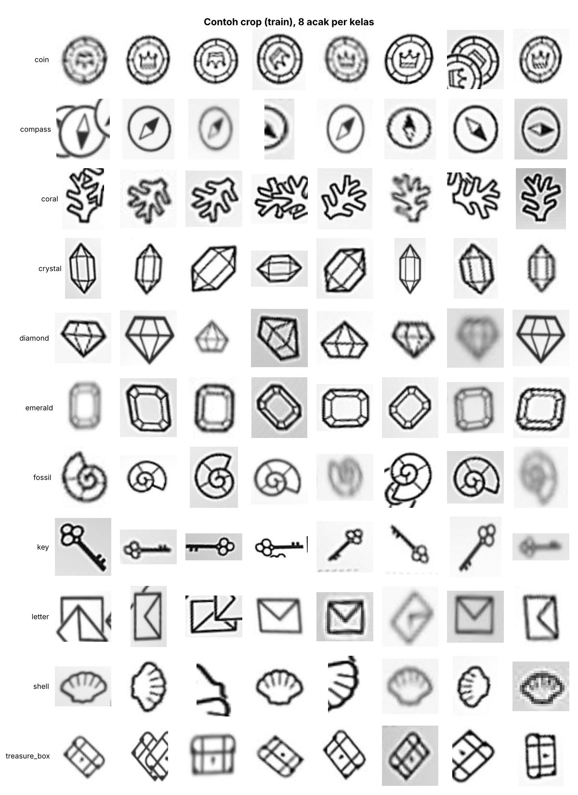

# Datasheet Dataset: `crop-aja` (Kibo-RPC) – versi klasifikasi

Mengikuti format *Datasheets for Datasets* (Gebru dkk.) secara ringkas.

## 1. Identitas

| | |
|---|---|
| Nama | crop aja (Roboflow project `brail-nyx-88/crop-aja`), versi 10 |
| Sumber | <https://universe.roboflow.com/brail-nyx-88/crop-aja> |
| Lisensi | CC BY 4.0 |
| Format asli | YOLOv8 (deteksi objek), diekspor dari Roboflow pada 3 Oktober 2026 |
| Format yang dipakai di repo ini | Klasifikasi gambar (hasil crop bounding box oleh `src/make_crops.py`) |
| Konteks | Gambar dikumpulkan untuk kompetisi Kibo-RPC (robot Astrobee); objek adalah ikon "harta karun" yang harus dikenali robot |

## 2. Komposisi

**Dataset asli (deteksi):** 799 gambar, 12 kelas, ukuran 320×220 px (di-*stretch* oleh Roboflow, auto-orient). Tidak ada augmentasi yang tercantum pada ekspor. Satu gambar bisa berisi beberapa objek. Split Roboflow: train 645 / valid 77 / test 77 gambar.

**Kelas (urutan `data.yaml`):** `aexample`, `coin`, `compass`, `coral`, `crystal`, `diamond`, `emerald`, `fossil`, `key`, `letter`, `shell`, `treasure_box`.

**Dataset klasifikasi (hasil crop):**

| Kelas | Train | Valid | Test |
|---|---:|---:|---:|
| coin | 145 | 13 | 10 |
| compass | 141 | 13 | 15 |
| coral | 164 | 14 | 22 |
| crystal | 115 | 11 | 14 |
| diamond | 96 | 16 | 14 |
| emerald | 113 | 11 | 10 |
| fossil | 151 | 24 | 11 |
| key | 159 | 15 | 20 |
| letter | 168 | 21 | 17 |
| shell | 163 | 17 | 24 |
| treasure_box | 143 | 15 | 18 |
| **Total** | **1.558** | **170** | **175** |

Ukuran crop rata-rata ±71×73 px (min 13×18, maks 178×168). Kelas relatif seimbang (96–168 contoh per kelas di train).

Objek berupa **ikon garis hitam di latar putih/abu-abu**. Beberapa crop buram (motion blur), terpotong di tepi gambar, atau memuat sebagian objek lain yang berdekatan.

## 3. Proses pengumpulan dan pengolahan

- Gambar asli: frame kamera (nama file `DEBUG_RGB_PreTFLite_<timestamp>_png...` menunjukkan frame debug dari pipeline TFLite, diambil berurutan dengan selang beberapa detik). Diberi anotasi bounding box di Roboflow.
- Pra-pemrosesan Roboflow: auto-orient, resize 320×220 (stretch).
- Pra-pemrosesan di repo ini (`src/make_crops.py`):
  1. Crop tiap bounding box dengan margin tambahan 10%.
  2. Buang crop dengan sisi < 8 px (tidak ada yang terbuang pada data ini).
  3. **Buang kelas `aexample`**: hanya 1 instance (di test set) dan tidak punya contoh train/valid, sehingga tidak bisa dipelajari. Nama kelasnya mengindikasikan placeholder.
  4. Split mengikuti split Roboflow; crop mewarisi split gambar sumbernya.
- Saat training, crop di-resize ke 144×144 lalu di-crop acak 128×128 (lihat README).

## 4. Penggunaan yang disarankan

- Klasifikasi objek Kibo-RPC, benchmark transfer learning skala kecil, pembelajaran/praktikum.
- Bukan untuk: menilai performa deteksi, klaim generalisasi ke lingkungan lain, atau sistem keselamatan.

## 5. Keterbatasan dan risiko (penting dibaca)

1. **Kemungkinan kemiripan antar-split.** Frame diambil berurutan dari lingkungan yang sama dan split Roboflow bersifat acak per frame, sehingga gambar train dan test bisa memuat objek yang sama dari sudut/waktu yang berdekatan. Ini membuat skor test cenderung optimis. Repo ini tidak melakukan pengecekan duplikasi antar-split.
2. **Test set kecil** (175 crop; 10–24 per kelas). Satu kesalahan = 0,57% akurasi, dan akurasi 100% pada 175 sampel hanya berarti tingkat kesalahan sebenarnya kemungkinan di bawah ±1,7% (aturan tiga, 95%).
3. **Domain sempit:** satu kamera, satu jenis latar dan pencahayaan, objek berupa ikon cetak. Model belum teruji pada objek 3D, pencahayaan lain, atau kamera lain.
4. **Kelas `aexample`** dibuang; kelas "tidak dikenal/latar belakang" tidak ada, jadi model akan selalu memilih salah satu dari 11 kelas.
5. **Crop dari ground-truth**, jadi kesalahan lokalisasi detektor tidak tercermin.
6. Kualitas anotasi tidak diaudit di repo ini.
7. Dataset tidak memuat data pribadi (gambar ikon objek).

## 6. Distribusi, pemeliharaan, atribusi

- Gambar **tidak** disertakan di repo; unduh dari Roboflow Universe (CC BY 4.0, wajib atribusi ke pembuat dataset `brail-nyx-88`).
- Perubahan dataset di Roboflow (versi baru) dapat mengubah jumlah gambar/kelas; hasil di repo ini berlaku untuk **versi 10**.
