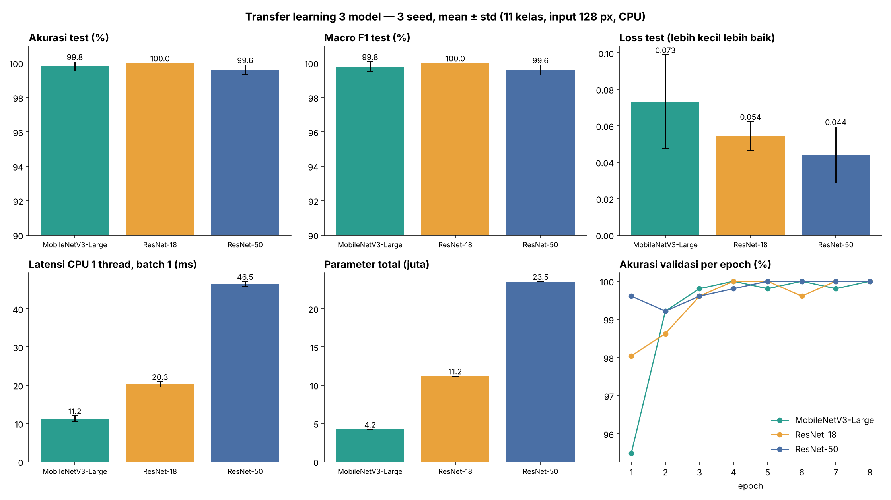
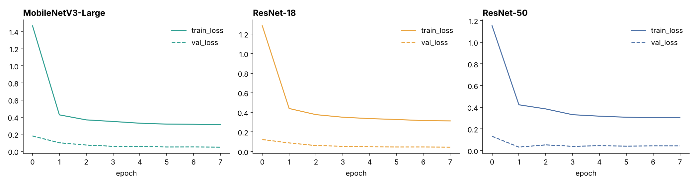
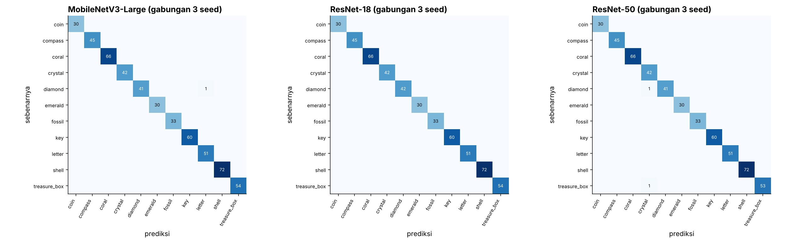

# Hasil dan Penjelasan Chart

Semua angka berasal dari `results/raw/*.json` (9 run: 3 model × seed 1, 2, 3) dan dirangkum di `results/ringkasan_model.csv` dan `results/hasil_per_seed.csv`. "± " adalah simpangan baku populasi dari 3 seed (n kecil, anggap sebagai indikasi kasar).

## 1. Chart utama: `perbandingan_model.png`

| Panel | Cara membaca | Temuan |
|---|---|---|
| **Akurasi test (%)** | Persentase 175 crop test yang diklasifikasikan benar. Batang = rata-rata 3 seed, garis = ± std. Sumbu y dipotong mulai 90% agar selisih kecil terlihat. | ResNet-18 100,0; MobileNetV3-L 99,8; ResNet-50 99,6. Ketiganya berbeda ≤ 0,4 poin. |
| **Macro F1 (%)** | Rata-rata F1 per kelas (tiap kelas sama bobotnya). | Pola sama dengan akurasi, jadi tidak ada kelas yang "dikorbankan". |
| **Loss test** | Cross-entropy di test set; makin kecil makin yakin dan benar. | ResNet-50 0,044 < ResNet-18 0,054 < MobileNetV3-L 0,073, tetapi error bar saling tumpang-tindih. |
| **Latensi CPU (ms)** | Median waktu satu inferensi (1 gambar, 1 thread CPU, 128×128). | MobileNetV3-L 11,2 < ResNet-18 20,3 < ResNet-50 46,5. Selisih besar dan stabil antar-run. |
| **Parameter total (juta)** | Ukuran model dengan classifier 11 kelas. | 4,2 / 11,2 / 23,5 juta (dengan head 1000 kelas ImageNet: 5,5 / 11,7 / 25,6). |
| **Akurasi validasi per epoch** | Rata-rata 3 seed per epoch. | Ketiganya ≥ 99,5% sejak epoch 3; MobileNetV3-L mulai paling rendah (±95,5% di epoch 1), ResNet-50 paling stabil sejak awal. |

## 2. Tabel lengkap

| Model | Akurasi (%) | Macro F1 (%) | Loss test | Latensi (ms) | Parameter total (jt) | Parameter dilatih (jt) | Waktu training (s) |
|---|---|---|---|---|---|---|---|
| MobileNetV3-Large | 99,81 ± 0,27 | 99,80 ± 0,28 | 0,073 ± 0,026 | 11,2 | 4,21 | 3,42 | 122 |
| ResNet-18 | 100,00 ± 0,00 | 100,00 ± 0,00 | 0,054 ± 0,008 | 20,3 | 11,18 | 8,40 | 163 |
| ResNet-50 | 99,62 ± 0,27 | 99,59 ± 0,29 | 0,044 ± 0,015 | 46,5 | 23,53 | 14,99 | 430 |

Waktu training = 8 epoch di CPU 2 core. "Parameter dilatih" = stage terakhir + classifier yang tidak dibekukan.

**Per seed** (`results/hasil_per_seed.csv`):

| Model | Seed | Epoch terbaik | Akurasi val (%) | Akurasi test (%) | F1 test (%) | Loss test |
|---|---|---|---|---|---|---|
| MobileNetV3-Large | 1 | 2 | 100 | 99,43 | 99,40 | 0,110 |
| MobileNetV3-Large | 2 | 3 | 100 | 100 | 100 | 0,055 |
| MobileNetV3-Large | 3 | 4 | 100 | 100 | 100 | 0,055 |
| ResNet-18 | 1 | 3 | 100 | 100 | 100 | 0,043 |
| ResNet-18 | 2 | 4 | 100 | 100 | 100 | 0,061 |
| ResNet-18 | 3 | 4 | 100 | 100 | 100 | 0,059 |
| ResNet-50 | 1 | 3 | 100 | 100 | 100 | 0,043 |
| ResNet-50 | 2 | 2 | 100 | 99,43 | 99,43 | 0,026 |
| ResNet-50 | 3 | 1 | 100 | 99,43 | 99,35 | 0,063 |

## 3. Kurva loss: `kurva_loss.png`

Garis penuh = loss train, putus-putus = loss validasi (rata-rata 3 seed). Loss train memakai label smoothing 0,05 sehingga nilainya tidak bisa turun mendekati 0 dan tidak sebanding langsung dengan loss validasi. Yang perlu dilihat: kedua kurva turun bersama dan tidak ada tanda overfitting yang jelas dalam 8 epoch.

## 4. Confusion matrix: `confusion_matrix.png`

Baris = kelas sebenarnya, kolom = prediksi, jumlah dari 3 seed (3 × 175 = 525 prediksi per model). Hampir semua nilai ada di diagonal. Seluruh kesalahan dari 9 run hanyalah **3 prediksi salah dari 1.575**:

| Model | Seed | Sebenarnya | Diprediksi |
|---|---|---|---|
| MobileNetV3-Large | 1 | diamond | letter |
| ResNet-50 | 2 | treasure_box | crystal |
| ResNet-50 | 3 | diamond | crystal |

Tiga kasus ini terlalu sedikit untuk menyimpulkan pola kebingungan antar-kelas; kemungkinan besar terkait crop yang buram/terpotong.

## 5. Analisis dan pemilihan model

1. **Akurasi tidak membedakan model.** Perbedaan antar model berasal dari 0–1 gambar salah per run. Dengan test set 175 gambar, satu gambar = 0,57%, lebih besar daripada selisih rata-rata antar model.
2. **Yang membedakan adalah biaya komputasi.** MobileNetV3-Large 4× lebih cepat dan 5,6× lebih kecil daripada ResNet-50, dengan akurasi yang setara. Ini sejalan dengan tabel slide kuliah ("MobileNetV3: Raspberry Pi tanpa GPU; ResNet-50: workstation GPU").
3. **Rekomendasi.**
   - Untuk robot/edge (Raspberry Pi, tanpa GPU): **MobileNetV3-Large**.
   - Jika ingin hasil paling stabil dan kecepatan masih memadai: **ResNet-18**.
   - **ResNet-50** tidak terbenarkan untuk dataset ini; kapasitas lebih besar tidak memberi keuntungan terukur.
4. **Mengapa hasilnya jenuh?** Objek adalah ikon garis hitam yang sangat berbeda bentuk (lihat `docs/img/contoh_crop.png`), akurasi validasi sudah 95,5–99,6% setelah 1 epoch (rata-rata 3 seed), dan checkpoint terbaik (100% val) dicapai pada epoch 1–4 di semua run.

## 6. Keterbatasan kesimpulan

- **Kemungkinan kebocoran antar-split:** frame berurutan dari lingkungan yang sama dibagi acak ke train/valid/test (lihat `DATASHEET.md` bagian 5), sehingga skor test kemungkinan terlalu optimis. Untuk klaim generalisasi, uji dengan frame dari sesi/pencahayaan lain.
- **Validasi jenuh (100%)** membuat pemilihan checkpoint "epoch terbaik" tidak informatif (diambil epoch pertama yang mencapai 100%).
- **Satu strategi transfer learning** (partial fine-tuning). Feature extraction saja dan training dari nol (scratch) tidak diuji di repo ini.
- **Latensi** diukur di CPU server, bukan perangkat target, dan tanpa optimasi (ONNX/TFLite/kuantisasi).
- **Bobot pretrained dari `pytorchcv`**, bukan `torchvision` (lihat README).
- Hanya 3 seed; std dari 3 titik hanyalah gambaran kasar.

## 7. Ide lanjutan

- Bandingkan `feature extraction` vs `partial` vs `scratch` (sesuai alur praktikum di slide).
- Bagi data berdasarkan sesi/waktu pengambilan agar tidak ada frame mirip lintas split.
- Ekspor ke ONNX/TFLite dan ukur latensi di perangkat target.
- Tambahkan kelas "latar belakang/tidak dikenal" dan uji end-to-end dengan detektor (mis. YOLO).
